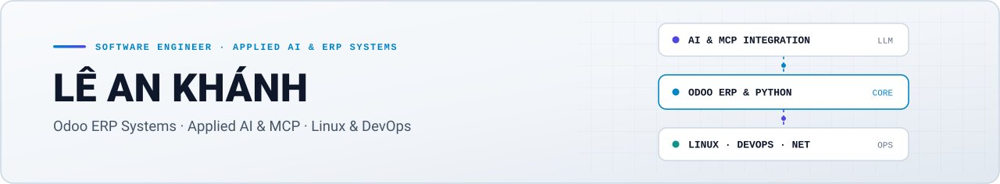

  <picture>
    <source media="(prefers-color-scheme: dark)" srcset="./assets/banner-dark.svg">
    <source media="(prefers-color-scheme: light)" srcset="./assets/banner-light.svg">
    
  </picture>

  

    Ho Chi Minh City, Vietnam &nbsp;·&nbsp;
    <a href="https://www.linkedin.com/in/leankhanh/">LinkedIn</a> &nbsp;·&nbsp;
    <a href="mailto:leankhanh2001@gmail.com">Email</a>
  

---

I am a **Software Engineer** specializing in **Odoo ERP systems**, **applied AI integration**, and **Linux / DevOps infrastructure**.

Most of my day-to-day work lives in private production systems — owning enterprise projects end-to-end from domain analysis and system design to backend engineering, network/security operations, and practical AI tooling.

### What I Build & Operate

| Domain | Scope & Stack |
| :--- | :--- |
| **Odoo ERP & Backend** | Odoo (v17–v19), OWL, Python, PostgreSQL, ORM performance tuning, API & third-party integrations, technical architecture |
| **Infrastructure & Security** | Linux server administration, Docker, CI/CD pipelines, multi-site VPN & networking, security hardening, monitoring |
| **Applied AI Systems** | MCP servers, agentic developer workflows, RAG & internal knowledge systems, practical LLM integration for business operations |

### Selected Public Repositories

| Repository | Focus | Summary |
| :--- | :--- | :--- |
| [codex-antigravity-mcp-plugin](https://github.com/khanhlean/codex-antigravity-mcp-plugin) | `AI / MCP` | MCP server and bridge enabling Codex to delegate tasks to Google Antigravity CLI |
| [Odoo-Devtool](https://github.com/khanhlean/Odoo-Devtool) | `Odoo / DX` | Developer productivity tooling for day-to-day Odoo engineering workflows |
| [odoo-ci](https://github.com/khanhlean/odoo-ci) | `DevOps / CI` | Containerized CI setup for running automated Odoo / OCA test suites |

### Currently Focusing On

- Designing maintainable **Odoo ERP architectures** for multi-company enterprise operations.
- Building **MCP servers** and **agentic workflows** that connect LLMs safely to real ERP and internal knowledge systems.
- Standardizing **DevOps, CI/CD, and security baselines** across self-hosted Linux and multi-site infrastructure.
